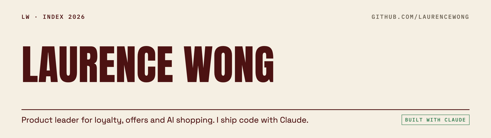

<picture>
  <source media="(prefers-color-scheme: dark)" srcset="assets/profile-dark.png">
  
</picture>

I've spent ten years deciding which offer a customer sees and what it costs. Now I build the AI that helps them shop.

I'm not an engineer by training. I ship code anyway, with Claude. My fleet of about ten agents runs my calendar, inbox, research and writing every day. Evals and a permission layer hold anything outward-facing for my approval.

**Now** · building one small tool or skill a day in public.

### The index

| No. | Work | What it is |
|---|---|---|
| LW‑01 | [job-application-skills](https://github.com/laurencewong/job-application-skills) | Claude Code skills that tailor resumes and answer applications using only verified facts. Rule zero: no lying. |
| LW‑02 | [conversation-design-playbook](https://github.com/laurencewong/conversation-design-playbook) | How to design LLM shopping and advice assistants, with 8 skills, era-tagged principles and credited sources. |
| LW‑03 | [agent-fleet-patterns](https://github.com/laurencewong/agent-fleet-patterns) | The patterns behind my agent fleet, including a governed tool boundary and headless runners that don't silently die. |
| LW‑04 | [field-manuals](https://github.com/laurencewong/field-manuals) | Production notes for people running AI agents. |
| LW‑06 | [second-brain-notes](https://github.com/laurencewong/second-brain-notes) | Video breakdowns and thinker profiles from my notes system. A new note every weekday. |

### What I care about
- **Loyalty economics.** Every discount is a P&L line.
- **Evals before vibes.** If you can't measure it, you're guessing.
- **PMs who can build.** The gap between PM and engineer is collapsing.

Product lead for an AI shopping assistant at Sephora. Before that, loyalty at Sephora. Promotions and the shopping list at Albertsons. · [LinkedIn](https://www.linkedin.com/in/laurencewongg)
